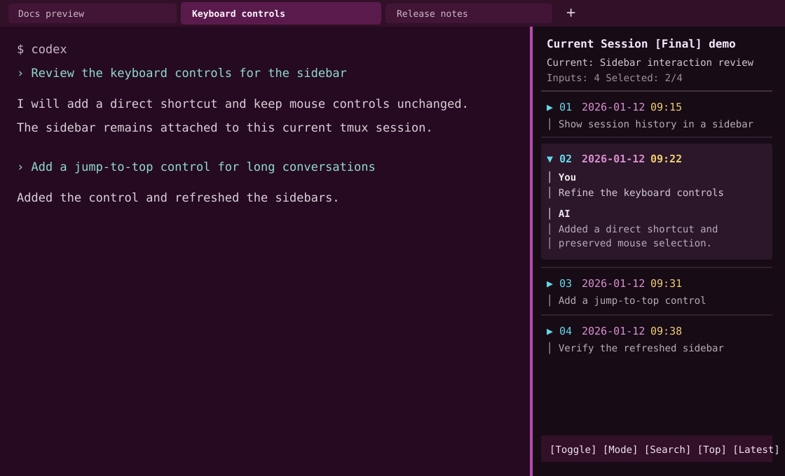

# tmux-context

[中文文档](README.zh-CN.md)

`tmux-context` automatically names tmux sessions from the completed Codex or Claude Code task, shows a mouse-enabled sidebar for the current conversation, and keeps compatible terminal titles in sync.

**Creator website:** [xzzoo7.com](https://xzzoo7.com/)

## Preview



This is a deliberately fictional demonstration. The tab strip shows different task-based session names, while the active tab shows its current-session sidebar. It contains no user name, account, filesystem path, host name, session ID, or real conversation content.

## Support boundary

| Environment | Support | Notes |
|---|---|---|
| Linux terminal | Full | Requires Python 3.10+ and tmux 3.2+ |
| Windows Terminal + WSL2 | Full | Recommended Windows configuration |
| Windows PowerShell | Bridge | PowerShell invokes the same runtime inside WSL2 |
| Native PowerShell without WSL | Unsupported | tmux, `/proc`, and curses require a POSIX host |

PowerShell compatibility means that you can install, launch, diagnose, and attach from PowerShell while the session itself runs in WSL. It does not ship a separate Windows tmux implementation.

## Supported AI CLIs

| CLI | Transcript | Detection |
|---|---|---|
| Codex | `$CODEX_HOME/sessions/rollout-*.jsonl` | Open file descriptor of the pane process, or `CODEX_THREAD_ID` |
| Claude Code | `$CLAUDE_CONFIG_DIR/projects/<cwd slug>/<session-id>.jsonl` | Pane process working directory, matched to the transcript that started with it |

Claude Code closes its transcript between writes, so the session is matched by the recorded `cwd` and the closest transcript start time. Concurrent Claude sessions in the same directory therefore stay on their own sidebar.

## Features

- Session titles prioritize the most recent meaningful task whose Codex or Claude Code response has completed.
- Weak text such as `继续`, raw shell commands, and image placeholders does not rename a session.
- The current-session sidebar supports mouse selection, collapsing one prompt at a time, expanding AI replies, scrolling, filtering, and hiding/showing reasoning output.
- Claude Code thinking blocks and interim answers between tool calls are treated as reasoning output, so only the closing answer of a turn is shown in the final-answer view.
- Click a conversation once to expand or collapse it. Drag text in an expanded conversation to copy only the selected body text; headers, timestamps, and separators are excluded.
- On WSL, selected text is copied through Windows PowerShell with UTF-8 input, preserving Chinese and other Unicode text.
- Clipboard writes run in the background, so the selection highlight remains responsive while copying.
- Dragging text in a normal tmux pane copies it and returns to the original position, so historical output stays at its current location.
- Terminal titles use the tmux session name, with Windows Terminal setup available as an explicit command.
- Managed `codex resume` launches reconnect to an existing live tmux writer instead of starting a second writer for the same thread.
- Managed sessions close when their launch command exits or their last tmux client leaves, without leaving a sidebar or login shell behind.
- `Ctrl-b H` toggles the sidebar; `Ctrl-b R` refreshes the current session name.

## Install from WSL or Linux

Install prerequisites, then clone the repository into the Linux filesystem:

```bash
sudo apt update
sudo apt install -y python3 tmux git
git clone https://github.com/<your-account>/tmux-context.git ~/workspace/tmux-context
cd ~/workspace/tmux-context
chmod +x tmux-context install.sh
./install.sh
./tmux-context doctor
```

Start an AI CLI from a regular shell so `tmux-context` can create the managed session and title watcher:

```bash
./tmux-context run --name assistant -- codex
./tmux-context run --name assistant -- claude
```

If neither `codex` nor `claude` is the command you use, replace it with the actual executable and arguments. Running `tmux-context run` inside an existing tmux client deliberately does not create a nested tmux server.

For a managed Codex launcher, `resume <thread-id>` attaches directly when that thread is already live. The normal Codex picker is preserved when no ID is supplied; if the selected thread has a live writer, `tmux-context` switches the client to its existing tmux session after Codex reports the conflict. Inactive saved sessions still use the native Codex resume path.

A managed session follows the lifetime of its foreground entrypoint. It ends when the launched Codex or other command exits, or when the last tmux client detaches because of a normal detach, a closed terminal window, or a terminal crash. Closing one of several terminal windows attached to the same session leaves the remaining clients untouched; cleanup occurs only after the last one leaves. This behavior is restricted to sessions marked `@session_context_managed=1` by `tmux-context run`. Ordinary tmux sessions are unaffected, and the global `destroy-unattached` option remains off.

Lifecycle cleanup ends tmux panes and their processes only. It does not invoke Codex `/delete` or remove transcripts under `$CODEX_HOME/sessions`; permanent conversation deletion remains an explicit user action in Codex.

## Install and use from PowerShell

Clone the repository either in a Windows folder mounted by WSL (for example `C:\Users\<user>\source\tmux-context`) or in the WSL filesystem. In a PowerShell window opened at the repository root:

```powershell
Set-ExecutionPolicy -Scope Process Bypass
.\Install-TmuxContext.ps1 -Distribution Ubuntu
.\tmux-context.ps1 doctor
.\tmux-context.ps1 run --name assistant -- codex
```

`-Distribution` is optional when only one distribution is installed. If the repository is in a nonstandard WSL path, pass it explicitly:

```powershell
.\tmux-context.ps1 -Distribution Ubuntu -WslPath /home/<linux-user>/workspace/tmux-context doctor
```

`Install-TmuxContext.ps1` installs the tmux hook and, by default, updates Windows Terminal settings. Use `-SkipWindowsTerminal` to only install tmux integration.

## Windows Terminal titles

From WSL:

```bash
./tmux-context enable-windows-title
```

or from PowerShell:

```powershell
.\tmux-context.ps1 enable-windows-title
```

This backs up `settings.json`, sets `suppressApplicationTitle: false` for WSL profiles, and adds `Ctrl+Shift+F12` for the Windows Terminal tab-title editor. Close all Windows Terminal windows after changing settings. For an old manually fixed tab title, focus the tab, press `Ctrl+Shift+F12`, then `Ctrl+A`, `Backspace`, and `Enter`.

## Commands

| Command | Purpose |
|---|---|
| `./tmux-context install` | Generate config and install the managed tmux hook |
| `./tmux-context uninstall` | Remove only this tool's managed tmux hook |
| `./tmux-context doctor` | Check tmux, entrypoint, generated config, and Windows Terminal discovery |
| `./tmux-context run --name <name> -- <command>` | Create and attach a managed tmux session |
| `./tmux-context client <session-id>` | Attach to an existing session with terminal-title monitoring |
| `./tmux-context activate <thread-id>` | Attach or switch to the live tmux session that owns a Codex thread |
| `./tmux-context enable-windows-title` | Configure Windows Terminal WSL title support |

## Tests

```bash
python3 -m unittest discover -s tests -v
git diff --check
```
